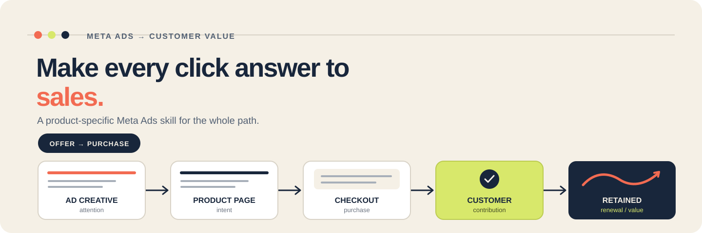

<p align="center">
  
</p>

<h1 align="center">Meta Ads Skills for Digital Products (SaaS, Courses, Communities/Memberships, PDFs/Ebooks, Downloads, Templates, and Plugins)</h1>

<p align="center">A practical, portable AI skill for founders and creators selling SaaS, downloads, courses, communities, templates, and plugins.</p>

<p align="center">
  <a href="#install">Install the skill</a> &nbsp;·&nbsp;
  <a href="#choose-your-product-path">Choose your product path</a> &nbsp;·&nbsp;
  <a href="#how-it-works">How it works</a>
</p>

<p align="center">
  <a href="LICENSE"></a>
  
  
</p>

---

## Ads should earn customers, not just activity

Clicks, views, and cheap signups can look busy while sales stay flat. This skill helps an AI agent work the whole path—from offer and unit economics to creative, checkout, purchase tracking, and retention—using **your product, your numbers, and your evidence**.

It adapts the strategy to how your product is sold. A SaaS trial needs activation and paid conversion. A template needs a clear preview and a smooth checkout. A membership needs renewals, not just joins.

**The aim is better decisions that support profitable sales. No ad skill can guarantee sales or ROAS.**

## Choose your product path

| What you sell | What the skill helps you account for |
| --- | --- |
| **SaaS** | Trial-to-paid conversion, activation, churn, payback, and retained revenue |
| **PDFs and downloads** | Offer clarity, checkout friction, fees, bundles, and refunds |
| **Video courses** | Consideration time, proof, curriculum claims, payment plans, and refund windows |
| **Paid communities** | Join-to-renewal quality, participation, and member retention |
| **Templates** | Previews, use cases, compatibility, licensing, and support expectations |
| **Plugins** | Platform fit, install-to-activation, trial-to-paid, and ongoing support |

## How it works

| Understand the economics | Build the sales path | Improve from evidence |
| --- | --- | --- |
| Clarify the buyer, offer, price, margins, refund exposure, and capacity before choosing a spend target. | Match the ad to the page, checkout, and purchase event. Create distinct image and video concepts with claims you can support. | Reconcile Meta and business data, find the earliest measured bottleneck, and run a bounded test with a clear decision rule. |

### What you can ask it to do

- **Plan a launch:** get a readiness verdict, unit-economics worksheet, funnel/event map, campaign test matrix, original ad concepts, QA list, and spend cap.
- **Diagnose weak sales:** compare delivery, clicks, product-page conversion, checkout, purchase, refunds, activation, and retention to find where evidence points.
- **Create stronger ads:** turn real customer language and product proof into distinct hooks, scripts, image directions, and landing-page messages.
- **Decide what to do next:** continue, revise, pause, or scale based on mature cohorts and your own contribution targets.

## Install

### Use it with Codex, Claude, Grok, and other LLMs

This repository packages the skill in the open [Agent Skills format](https://agentskills.io/specification). The skill instructions and reference files are model-agnostic: use them with Codex, Claude Code, Grok, or another LLM host that supports Agent Skills. Each host has its own skill discovery and install rules, so follow that host's documentation.

For hosts without native Agent Skills support, download the ZIP and provide `SKILL.md` plus the relevant `references/` files as context. A chat interface that cannot retain files or instructions may require you to attach them again in each conversation.

#### Codex and Grok

The default installer location `~/.agents/skills/` is supported by Codex and Grok. With Node.js 18 or newer:

```bash
npx --yes --package=https://github.com/pritoo733/Meta-Ads-Skills-for-Digital-Products/archive/refs/heads/main.tar.gz meta-ads-digital-products-install
```

The installer adds or updates `meta-ads-digital-products` in `~/.agents/skills/`. It preserves neighboring skills and files. The skill is available to the agent on its next turn.

#### Claude Code

Claude Code uses `~/.claude/skills/` for personal skills. Install there with the repository installer:

```bash
npx --yes --package=https://github.com/pritoo733/Meta-Ads-Skills-for-Digital-Products/archive/refs/heads/main.tar.gz meta-ads-digital-products-install --dest ~/.claude/skills
```

### Manual install

Download [`dist/meta-ads-digital-products.zip`](dist/meta-ads-digital-products.zip), extract it, and copy the complete `meta-ads-digital-products` folder into the skill directory documented by your AI host. Or, after cloning this repository, run:

```bash
node scripts/install.mjs
```

To install for a host with a different skills directory (for example, Claude Code):

```bash
node scripts/install.mjs --dest /path/to/your/skills
```

The installer writes the folder inside the directory you specify. It does not configure the host, enable tools, or guarantee that a platform discovers skills from that path; check the host's current skill documentation.

## Try it

**SaaS launch**

> Use `meta-ads-digital-products` to plan a Meta Ads test for my SaaS. Here are our price, gross margin, trial activation and paid conversion data, refund/cancellation terms, customer profile, and budget cap. Show the assumptions, event plan, creative hypotheses, and the rule for deciding what to do next.

**Download audit**

> Use `meta-ads-digital-products` to diagnose this PDF checkout funnel. Compare spend, landing page visits, checkout starts, purchases, fees, refunds, and net contribution. Identify the earliest evidence-backed bottleneck and propose one capped test.

**Course creative**

> Use `meta-ads-digital-products` to create three distinct Meta ad concepts for this course from the customer interviews and approved proof below. Give each concept a hook, format-specific execution, copy, claim notes, destination match, and success metric.

**Membership retention**

> Use `meta-ads-digital-products` to review these community acquisition cohorts. Separate joins from renewals and retained contribution, account for the refund window, and tell me what is and is not mature enough to decide.

Bring real prices, fees, margins, funnel counts, customer language, and the date range. The skill labels assumptions and missing evidence instead of filling gaps with invented benchmarks.

## Built for sales. Grounded in evidence.

- **No fake proof.** It does not invent testimonials, customer results, conversion benchmarks, or guaranteed returns.
- **No vanity-metric verdicts.** Click-through rate can explain a stage; it does not prove profitable customer acquisition.
- **No one-size-fits-all funnel.** A one-time download, subscription, course, and plugin need different economics and evaluation windows.
- **No implied account access.** The skill itself cannot see or change your Meta account, website, payment system, or CRM.
- **Current controls matter.** Verify current Meta campaign options, ad standards, data rules, and local privacy requirements before changing live campaigns.
- **Research has limits.** The packaged [research basis](meta-ads-digital-products/references/research-basis.md) lists its sources and separates platform guidance from self-reported case studies.

## What's inside

```text
meta-ads-digital-products/
├── SKILL.md
├── LICENSE
├── references/
│   ├── offer-and-demand.md
│   ├── economics.md
│   ├── funnel-and-measurement.md
│   ├── creative-and-conversion.md
│   ├── product-playbooks.md
│   ├── testing-and-optimization.md
│   ├── policy-and-proof.md
│   └── research-basis.md
└── templates/
    ├── intake.md
    ├── unit-economics.md
    ├── launch-brief.md
    ├── creative-matrix.md
    ├── event-map-and-qa.md
    └── cohort-review.md
```

This is an independent, community-maintained skill for Meta Ads. It is not affiliated with or endorsed by Meta. See [the skill references](meta-ads-digital-products/SKILL.md) and [MIT license](LICENSE).

---

<p align="center"><sub>Built for clearer tests, better customer signals, and decisions tied to the sale—not the screenshot.</sub></p>
